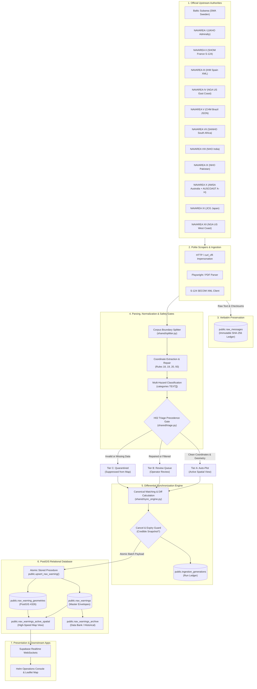

<div align="center">


</div>
# Helm.Warning.Backend — NAVAREA Maritime Safety Information Pipeline

[](LICENSE)
[](#-running-tests)
[](https://www.python.org/)
[](https://postgis.net/)
[](#-data-safety-and-synchronization)
[](#-supported-navarea-sources)
[](agent.md)

> **Official Maritime Safety Notice**: Automated extraction, parsing, and classification provided by this system are designed to assist watchstanders and operations personnel. They **do not replace official navigational safety broadcasts, statutory nautical publications, or the professional judgment of a certified Officer of the Watch (OOW)**. Always consult official Navigational Area (NAVAREA) coordinators and national hydrographic offices for navigational decisions.

---

## 📑 Table of Contents

- [🌊 What Is This Project?](#-what-is-this-project)
  - [What Are NAVAREA Warnings and NAVWARNs?](#what-are-navarea-warnings-and-navwarns)
  - [What This System Does](#what-this-system-does)
  - [What This System Does Not Do](#what-this-system-does-not-do)
  - [Target Audience](#target-audience)
  - [Relationship to the Helm.Warning Ecosystem](#relationship-to-the-helmwarning-ecosystem)
- [⏳ Project Timeline](#-helmwarningbackend--project-timeline)
- [🔄 How the Pipeline Works](#-how-the-pipeline-works)
  - [Pipeline Flowchart](#pipeline-flowchart)
  - [Stage-by-Stage Explanation](#stage-by-stage-explanation)
- [🌐 Supported NAVAREA Sources](#-supported-navarea-sources)
- [📂 Repository Structure](#-repository-structure)
  - [Directory Tree](#directory-tree)
  - [Shared Modules Overview](#shared-modules-overview)
- [⚡ Quick Start Guide](#-quick-start-guide)
  - [Prerequisites](#prerequisites)
  - [Installation](#installation)
  - [Running Tests](#running-tests)
  - [Executing a Safe Dry-Run Scrape](#executing-a-safe-dry-run-scrape)
- [⚙️ Configuration Reference](#️-configuration-reference)
  - [Environment Variables Table](#environment-variables-table)
  - [Creating Your Local `.env` File](#creating-your-local-env-file)
- [🛡️ Data Safety and Synchronization](#️-data-safety-and-synchronization)
  - [1. Deterministic Warning Identity (`canonical_id`)](#1-deterministic-warning-identity-canonical_id)
  - [2. Evidence-Based Lifecycle Transitions (Guarded Expiry & Cancellation)](#2-evidence-based-lifecycle-transitions-guarded-expiry--cancellation)
  - [3. Geometry-Preserving Atomic Upserts (`upsert_nav_warning` RPC)](#3-geometry-preserving-atomic-upserts-upsert_nav_warning-rpc)
  - [4. The H02 Triage Precedence Gate (Tiers A, B, C)](#4-the-h02-triage-precedence-gate-tiers-a-b-c)
  - [5. Verbatim Source Preservation & Immutable Audit Trail](#5-verbatim-source-preservation--immutable-audit-trail)
  - [6. Supabase Parsing Audit & AI Correction Engine](#6-supabase-parsing-audit--ai-correction-engine)
- [🤖 Agent Directives & Architecture (agent.md)](#-agent-directives--architecture-agentmd)
- [🔍 Monitoring and Troubleshooting](#-monitoring-and-troubleshooting)
  - [Operational Health & Run Ledgers](#operational-health--run-ledgers)
  - [Investigating Common Operational Scenarios](#investigating-common-operational-scenarios)
  - [Troubleshooting Reference Matrix](#troubleshooting-reference-matrix)
- [💻 Development Guide](#-development-guide)
  - [Branching & Contributing Workflow](#branching--contributing-workflow)
  - [Code Conventions for Human & AI Contributors](#code-conventions-for-human--ai-contributors)
- [➕ Adding a New Warning Source](#-adding-a-new-warning-source)
- [🔐 Security, Recovery, and Disaster Management](#-security-recovery-and-disaster-management)
- [📜 Contribution Guidelines and License](#-contribution-guidelines-and-license)
- [✅ Documentation Verification](#-documentation-verification)

---

## 🌊 What Is This Project?

### What Are NAVAREA Warnings and NAVWARNs?
Under the International Maritime Organization (IMO) and the International Hydrographic Organization (IHO) World-Wide Navigational Warning Service (WWNWS), the world’s oceans are divided into 21 geographic areas called **NAVAREAs**. Each NAVAREA is coordinated by an official national hydrographic authority responsible for broadcasting urgent **Navigational Warnings (NAVWARNs)**. These notices alert mariners to critical hazards, such as unexploded ordnance, drifting derelicts, broken navigational aids, live-fire naval exercises, submarine cable operations, and newly charted shoals.

### What This System Does
**Helm.Warning.Backend** is an automated data engineering pipeline that:
- **Collects** official navigational safety messages from supported hydrographic authorities via polite web scraping, PDF extraction, and modern S-124 SECOM XML endpoints.
- **Normalizes and Parses** diverse text and spatial formats (including degrees-minutes-seconds, decimal minutes, and GML polygons).
- **Applies Maritime Safety Gates** to validate coordinate bounds and verify geometric consistency.
- **Categorizes Hazards** into standardized maritime categories (e.g., *military exercises*, *aids to navigation*, *drifting hazards*, *underwater operations*).
- **Synchronizes State Safely** into a relational PostGIS database using non-destructive differential updates, cryptographic audit logs, and evidence-based lifecycle rules.

### What This System Does Not Do
- ❌ **It does NOT replace statutory navigation tools**: It is not an ECDIS (Electronic Chart Display and Information System) type-approved navigation device.
- ❌ **It does NOT delete historical records**: Records are never purged during routine synchronization; they transition between `active`, `cancelled`, and `expired` statuses.
- ❌ **It does NOT guess or clamp invalid coordinates**: If a coordinate has an invalid hemisphere or exceeds latitude $[-90, 90]$ or longitude $[-180, 180]$, it is quarantined for operator review rather than guessed.

### Target Audience
1. **Operators & Watchstanders**: Personnel monitoring scraper health, verifying bulletin counts, and reviewing flagged warnings.
2. **Software Engineers**: Developers maintaining source scrapers, refining parsing regexes, optimizing database queries, and extending automation.
3. **AI Coding Agents**: Automated tools maintaining the repository; this guide outlines project contracts, invariant safety rules, and restrictions against unnecessary rewrites.

### Relationship to the Helm.Warning Ecosystem
This repository serves as the authoritative data collection and processing engine. Downstream consumers—such as the **Helm Navigational Warning Operations Console** and the **Public Mariner Portal**—connect directly to the PostGIS spatial views and Supabase Realtime channels populated by this backend.

---

## ⏳ Helm.Warning.Backend — Project Timeline

### Phase 0 · Origins (Jan – Jun 2026)
Your maritime app journey began with vessel trackers, culminating in the first NAVAREA idea — an empty plotter repo (Jun 29).

### Phase 1 · First Scraper (Sep 2026)
**Sep 18** — First scraper ever built: **NAVAREA VIII** (NHO India) in `hydrobharat-navarea-scraper` (Liferay API + PDF parsing).

### Phase 2 · Standalone Repos (Oct 7–15)
**Oct 9** — Two dedicated repos, built in rapid bursts:
- `NAVAREA-BALTIC` → **NAVAREA I (UKHO)** scraper born here (Oct 9, 06:52)
- `NAVAREA-XI-JAPAN` → **NAVAREA XI** scraper (Japan Coast Guard)

### Phase 3 · Unified Backend (Oct 16–20)
**Oct 16** — All scrapers consolidated into `Helm.Warning.Backend` (shared infra, sync engine, CI, tests).
**Oct 19** — **NAVAREA II** added (S-124/SECOM); `scrapers/` package created.
**Oct 20** — Schema v24; NAVAREA II stabilized (XML ExchangeSet → Scrapling fetcher).

### Phase 4 · Expansion & Maturity (Oct 21–22)
**Oct 21** — **NAVAREA XII** & **NAVAREA IV** built from scratch; geometry validation hardened.
**Oct 22** — **NAVAREA VIII** full pipeline (full circle — first attempted, last completed); lifecycle-safety layer merged (PR #21).

### Phase 5 · Enterprise Parsing Audit & AI Correction Engine (Oct 26)
**Oct 26** — Enterprise Supabase Parsing Audit & AI Correction Engine launched (`scripts/audit_supabase_parsing.py`, `.github/workflows/supabase-parsing-audit.yml`, `migrations/20261026_parsing_audit.sql`). Full keyset pagination (`id > last_id`), fail-closed structured Gemini proposals, production-gated atomic RPC apply (admin_save_nav_warning + fail-closed model verification), pre-apply domain re-validation, plain `REFERENCES` foreign keys, and zero-secrets logging.

### Phase 6 · Safety Hardening & First Fully Green CI (Oct 27)
**Oct 27** — Parsing-audit engine safety-hardened (PR #34: RPC-gated atomic apply via `admin_save_nav_warning`, zero-write `audit_only` mode, fail-closed `gemini-3.8-flash` model verification, reduced AI allowlist, `confirm_apply` gate); duplicate audit implementation removed (PR #35); unknown-region `parse_provenance` stamp fixed (PR #36); 15 universal-parser fixture files restored byte-exact from git history (PR #37) — bringing the suite to its **first fully green CI run: 456 tests, 0 errors**.

---

### Phase 7 · Five New Coordinators + Geometry & Data-Quality Audit Wave (Oct 27–30)
**Oct 27–28** — Five new ingestion pipelines built and merged: **NAVAREA III** (IHM Spain XML snapshot), **NAVAREA V** (CHM Brazil JSON behind a Cloudflare wall, fetched via a curl_cffi → StealthyFetcher → Fetcher → requests ladder), **NAVAREA VII** (SANHO static HTML), **NAVAREA IX** (NHO Pakistan per-row documents, with a per-run request cap, loud skips and pre-2025 archiving), and **NAVAREA X** (AMSA Australia, including **AUSCOAST areas A–H** ingested as area-scoped pseudo-regions filed under NAVAREA X).
**Oct 28–30** — A read-only DB audit drove a merged fix wave: geometry-correctness gaps A1–A7 and coverage-gap coordinate syntaxes (PRs #63–#64); fail-closed validity-date extraction (F1, PR #66); evidence-based CANCEL cross-reference resolution gated behind `SYNC_APPLY_CANCEL_REFS` (F2, PR #67); hazard-classifier negative guards for cancel/retraction wording (F4, PR #68); `navarea` column normalization to bare coordinator codes plus a one-time backfill migration (F3, PRs #69/#72); title sentence cut, source-letter zone labels and NAVAREA IX UTF-8 decode (F5/F7/F9, PR #70). Rig lists now always plot as points and no buffer radius is ever invented. Suite grew to ~600 tests, CI green.

---

**In one sentence:** One idea (Jun) → one scraper (Sep 18) → standalone repos (Oct 9) → unified backend (Oct 16) → 7 regions + safety layer (Oct 22) → Enterprise Parsing Audit & AI Correction (Oct 26) → safety-hardened audit engine & first fully green CI (Oct 27) → 12 sources + geometry & data-quality audit wave (Oct 30).

---

## 🔄 How the Pipeline Works

The pipeline follows a multi-stage workflow designed to prevent corrupted data from ever reaching navigational displays.

### Pipeline Flowchart



### Stage-by-Stage Explanation

1. **Harvesting**: Dedicated scrapers politely query official portals. Depending on the authority, this uses HTTP GET with browser TLS fingerprinting (`curl_cffi`), headless browser pagination (`playwright`), or S-124 SECOM XML clients.
2. **Raw Preservation**: Before any transformations occur, the raw bulletin text is hashed with SHA-256 and stored in `public.raw_messages` to ensure an immutable legal audit trail.
3. **Boundary Splitting & Normalization**: Multi-message bulletins (such as daily digests) are segmented into individual warning blocks via `shared/splitter.py`.
4. **Coordinate Extraction & Repair**: Raw coordinate strings (DMS, DDM, DD) are parsed. Deterministic repair rules (such as Rule 18 for missing leading zeros or Rule 93 for polygon hemisphere inheritance) resolve typographical quirks without guessing.
5. **Multi-Hazard Classification**: Warnings are assigned standardized tag arrays (e.g., `["military", "drifting_hazard"]`) based on maritime terminology analysis.
6. **H02 Triage Precedence Gate**: Strict safety rules classify the warning into **Tier A** (rendered on live charts), **Tier B** (held for human review), or **Tier C** (quarantined/suppressed).
7. **Differential Synchronization**: The sync engine matches records against the database using a unique `canonical_id`. It determines which records are brand new, updated, unchanged, expired, or unobserved.
8. **Guarded Lifecycle & Run Ledger**: Missing warnings are protected by safety thresholds. A run record is logged in `public.ingestion_generations`.
9. **Atomic PostGIS Upsert**: The `public.upsert_nav_warning` stored procedure updates the master record and replaces child geometries within a single transaction, preserving historical geometries if an incoming parse produces an empty geometry set.
10. **Downstream Propagation**: Updated active warnings are exposed via `public.nav_warnings_active_spatial` and broadcast over Supabase Realtime WebSockets to operators and mariners.

---

## 🌐 Supported NAVAREA Sources

The following twelve international maritime warning feeds are implemented, tested, and actively scheduled:

| NAVAREA / Region | Publishing Authority | Official Source / Feed | Implementation Files | Automation Workflow | Operational Status |
| :--- | :--- | :--- | :--- | :--- | :---: |
| **Baltic Subarea** | Swedish Maritime Administration (*Sjöfartsverket*) | [Sjöfartsverket Warnings](https://www.sjofartsverket.se) | [`scripts/baltic_scraper.py`](scripts/baltic_scraper.py)<br/>[`scripts/baltic_parser.py`](scripts/baltic_parser.py)<br/>[`scripts/run_baltic.py`](scripts/run_baltic.py) | [`.github/workflows/baltic-sync.yml`](.github/workflows/baltic-sync.yml) *(Every 15 mins)* | ✅ **Active & Verified** |
| **NAVAREA I** | UK Hydrographic Office (*UKHO Admiralty*) | [UKHO Admiralty MSI Portal](https://www.admiralty.co.uk) | [`scripts/navarea_1_scraper.py`](scripts/navarea_1_scraper.py)<br/>[`scripts/navarea_1_parser.py`](scripts/navarea_1_parser.py)<br/>[`scripts/run_navarea_1.py`](scripts/run_navarea_1.py) | [`.github/workflows/navarea-1-sync.yml`](.github/workflows/navarea-1-sync.yml) *(Every 30 mins)* | ✅ **Active & Verified** |
| **NAVAREA II** | French Hydrographic Service (*SHOM*) | [SHOM SECOM S-124 Service](https://services.ping-info-nautique.fr) | [`scrapers/navarea_ii.py`](scrapers/navarea_ii.py) | [`.github/workflows/navarea_ii.yml`](.github/workflows/navarea_ii.yml) *(Every 30 mins)* | ✅ **Active & Verified** |
| **NAVAREA III** | Spanish Institute of Hydrography (*IHM*) | [IHM NAVAREAS XML Snapshot](https://armada.defensa.gob.es/ihm/XML/navareas_crudo.xml) | [`scripts/navarea_iii_scraper.py`](scripts/navarea_iii_scraper.py)<br/>[`scripts/run_navarea_iii.py`](scripts/run_navarea_iii.py) | [`.github/workflows/navarea-iii-sync.yml`](.github/workflows/navarea-iii-sync.yml) *(Daily 06:30 UTC)* | ✅ **Active & Verified** |
| **NAVAREA IV** | US National Geospatial-Intelligence Agency (*NGA*) | [NGA MSI Daily Memo IV](https://msi.nga.mil/apology_objects/DailyMemIV.txt) | [`scripts/navarea_iv_scraper.py`](scripts/navarea_iv_scraper.py)<br/>[`scripts/navarea_iv_parser.py`](scripts/navarea_iv_parser.py)<br/>[`scripts/run_navarea_iv.py`](scripts/run_navarea_iv.py) | [`.github/workflows/navarea-iv-sync.yml`](.github/workflows/navarea-iv-sync.yml) *(Every 6 hours)* | ✅ **Active & Verified** |
| **NAVAREA V** | Brazilian Navy Hydrographic Centre (*CHM*) | [CHM Avisos-Rádio Náuticos JSON](https://www.marinha.mil.br/chm/dados-do-segnav-aviso-radio-nautico-tela/avisos-radio-nauticos-e-sar) | [`scripts/navarea_v_scraper.py`](scripts/navarea_v_scraper.py)<br/>[`scripts/run_navarea_v.py`](scripts/run_navarea_v.py) | [`.github/workflows/navarea-v-sync.yml`](.github/workflows/navarea-v-sync.yml) *(Daily 07:30 UTC)* | ✅ **Active & Verified** |
| **NAVAREA VII** | South African Navy Hydrographic Office (*SANHO*) | [SANHO NAVAREA VII Messages](https://www.sanho.co.za/notices_mariners/navarea_v11_messages.htm) | [`scripts/navarea_vii_scraper.py`](scripts/navarea_vii_scraper.py)<br/>[`scripts/run_navarea_vii.py`](scripts/run_navarea_vii.py) | [`.github/workflows/navarea-vii-sync.yml`](.github/workflows/navarea-vii-sync.yml) *(Mon–Fri 08:30 UTC)* | ✅ **Active & Verified** |
| **NAVAREA VIII** | Indian National Hydrographic Office (*NHO India*) | [NHO India In-Force Portal](https://hydrobharat.gov.in) *(Mirror: SeaLagom)* | [`scripts/navarea_8_scraper.py`](scripts/navarea_8_scraper.py)<br/>[`scripts/navarea_8_parser.py`](scripts/navarea_8_parser.py)<br/>[`scripts/run_navarea_8.py`](scripts/run_navarea_8.py) | [`.github/workflows/navarea-8-sync.yml`](.github/workflows/navarea-8-sync.yml) *(Every 4 hours)* | ✅ **Active & Verified** |
| **NAVAREA IX** | Pakistan Navy Hydrographic Dept (*NHO Pakistan*) | [NHO Pakistan NAVAREA IX Warnings](https://hydrography.paknavy.gov.pk/navarea-ix-warnings/) | [`scripts/navarea_ix_scraper.py`](scripts/navarea_ix_scraper.py)<br/>[`scripts/run_navarea_ix.py`](scripts/run_navarea_ix.py) | [`.github/workflows/navarea-ix-sync.yml`](.github/workflows/navarea-ix-sync.yml) *(Daily 04:30 UTC)* | ✅ **Active & Verified** |
| **NAVAREA X** | Australian Maritime Safety Authority (*AMSA*) | [AMSA NAVAREA X Notice to Mariners](https://www.amsa.gov.au) *(incl. AUSCOAST areas A–H, filed under NAVAREA X)* | [`scripts/navarea_x_scraper.py`](scripts/navarea_x_scraper.py)<br/>[`scripts/run_navarea_x.py`](scripts/run_navarea_x.py) | [`.github/workflows/navarea-x-sync.yml`](.github/workflows/navarea-x-sync.yml) *(Daily 07:45 UTC)* | ✅ **Active & Verified** |
| **NAVAREA XI** | Japan Coast Guard (*JCG Kaiho*) | [JCG Kaiho Warning Service](https://www1.kaiho.mlit.go.jp) | [`scripts/navarea_xi_scraper.py`](scripts/navarea_xi_scraper.py)<br/>[`scripts/navarea_xi_parser.py`](scripts/navarea_xi_parser.py)<br/>[`scripts/run_navarea_xi.py`](scripts/run_navarea_xi.py) | [`.github/workflows/navarea-xi-sync.yml`](.github/workflows/navarea-xi-sync.yml) *(Every 30 mins)* | ✅ **Active & Verified** |
| **NAVAREA XII** | US National Geospatial-Intelligence Agency (*NGA*) | [NGA MSI Daily Memo XII](https://msi.nga.mil/apology_objects/DailyMemXII.txt) | [`scripts/navarea_xii_scraper.py`](scripts/navarea_xii_scraper.py)<br/>[`scripts/navarea_xii_parser.py`](scripts/navarea_xii_parser.py)<br/>[`scripts/run_navarea_xii.py`](scripts/run_navarea_xii.py) | [`.github/workflows/navarea-xii-sync.yml`](.github/workflows/navarea-xii-sync.yml) *(Every 6 hours)* | ✅ **Active & Verified** |
| **All Regions** | Master Orchestrator | *All above coordinators* | [`scripts/run_all.py`](scripts/run_all.py)<br/>[`scripts/run_all_async.py`](scripts/run_all_async.py) | [`.github/workflows/all-sync.yml`](.github/workflows/all-sync.yml) *(Every 6 hours)* | ✅ **Active & Verified** |

---

## 📂 Repository Structure

### Directory Tree

```text
.
├── .github/workflows/       # Automated sync schedules & parsing audit workflows
│   ├── all-sync.yml         # Master orchestrator workflow (all regions, every 6 hours)
│   ├── supabase-parsing-audit.yml # Manual dispatch: Audit, Propose, Apply (Production-Gated)
│   └── navarea-*-sync.yml   # Regional sync automation workflows
├── migrations/              # Versioned PostgreSQL & PostGIS database migrations
│   ├── 20261023_lifecycle_safety.sql # Run ledger, cancel guard & geometry preservation RPC
│   ├── 20261026_parsing_audit.sql    # Audit runs & correction proposals (plain REFERENCES)
│   └── 20261030_navarea_label_backfill.sql # One-time backfill: bare coordinator codes in navarea
├── scrapers/                # Specialized regional scrapers (e.g., S-124 SECOM XML, table scrapers)
│   ├── navarea_8.py         # NAVAREA VIII PDF fast-path scraper
│   ├── navarea_8_table.py   # NAVAREA VIII Playwright table scraper
│   └── navarea_ii.py        # NAVAREA II S-124 SECOM XML client
├── scripts/                 # Scraper wrappers, parsers, and regional sync runners
│   ├── audit_supabase_parsing.py # Keyset-paginated audit, proposal & atomic apply engine
│   ├── run_all.py           # Master synchronous runner across all regions
│   ├── run_all_async.py     # Concurrent asyncio master pipeline runner
│   ├── async_scraper.py     # Base async HTTP client with rate-limiting semaphores
│   ├── ai_parser.py         # Gemini 3.1 Flash-Lite AI coordinate fallback extractor
│   └── navarea_*_sync.py    # Region-specific ingestion orchestration
├── shared/                  # Core processing modules (REUSE THESE; DO NOT REINVENT)
│   ├── sync_engine.py       # Differential matching, cancel guards, generation logging & RPC caller
│   ├── models.py            # Dataclasses (TriageRecord, CoordinateProvenance) & payload builders
│   ├── triage.py            # H02 Triage Precedence gate & audit logger
│   ├── utils.py             # Coordinate normalization, centroid math & repair rules (18/19/20/93)
│   ├── geometry_classifier.py # Geometry archetype classification (areas, tracklines, point lists, rig rules)
│   ├── splitter.py          # Boundary splitter for multi-bulletin raw feeds
│   ├── config.py            # Centralized typed configuration & pre-flight validation
│   ├── circuit_breaker.py   # CLOSED -> OPEN -> HALF_OPEN fault-tolerance state machine
│   ├── retry.py             # Exponential backoff decorator with randomized jitter
│   ├── exceptions.py        # Contextual exception hierarchy (NavWarnError, ValidationError, etc.)
│   ├── logging.py           # Machine-ingestible JSON structured audit logger
│   ├── metrics.py           # Thread-safe Counters, Gauges, and Histograms
│   └── prometheus.py        # Embedded Prometheus HTTP exposition server (/metrics)
├── src/                     # React 19 / TypeScript Maritime Operations Console & Leaflet Portal
├── tests/                   # Python regression, property-based fuzzing, and unit test suites
│   ├── test_supabase_parsing_audit.py # Comprehensive tests for audit pagination, safety & apply
│   └── ...                  # ~600 automated unit and regression tests
├── agent.md                 # System prompt, invariants & technical reference for AI coding agents
├── requirements.txt         # Pinned Python backend dependencies
└── package.json             # Frontend dependencies and scripts
```

### Shared Modules Overview
To maintain consistency and data integrity, all regional scrapers rely on the shared modules in [`shared/`](shared/):
- **[`shared/sync_engine.py`](shared/sync_engine.py)**: The single point of entry for database synchronization. It handles differential calculations, canonical ID mapping, evidence-based cancellation guards, and calls the `upsert_nav_warning` RPC.
- **[`shared/utils.py`](shared/utils.py)**: Contains all coordinate extraction logic, DMS/DDM/DD parsers, and repair rules. Never write custom coordinate regexes in individual scrapers.
- **[`shared/geometry_classifier.py`](shared/geometry_classifier.py)**: Classifies extracted coordinates into geometry archetypes (bounded areas, tracklines, point lists, rig lists) for every region — one shared rule set, no per-scraper geometry code.
- **[`shared/triage.py`](shared/triage.py)**: Enforces the H02 safety gate. Ensures consistent assignment of Tiers A, B, and C across all regions.
- **[`shared/models.py`](shared/models.py)**: Defines shared data structures, canonical ID formatting, and builds JSON payloads for the database.
- **[`shared/circuit_breaker.py`](shared/circuit_breaker.py)**: Protects remote upstream authority servers from aggressive retry storms during outages.

---

## ⚡ Quick Start Guide

Follow these steps to set up and run the backend locally in a safe, non-destructive environment.

### Prerequisites
- **Python**: Version 3.11 or higher.
- **Node.js**: Version 20 or higher (optional, only needed for the frontend console).
- **Git**: Installed and configured.

### Installation

1. **Clone the repository**:
   ```bash
   git clone https://github.com/alfredpanakkal/Helm.Warning.Backend.git
   cd Helm.Warning.Backend
   ```

2. **Create and activate a Python virtual environment**:
   ```bash
   python3 -m venv .venv
   source .venv/bin/activate
   # On Windows: .venv\Scripts\activate
   ```

3. **Install Python dependencies**:
   ```bash
   pip install --upgrade pip
   pip install -r requirements.txt
   ```

4. **Install Playwright browser binaries** (required for NAVAREA VIII table scraping):
   ```bash
   playwright install chromium --with-deps
   ```

### Running Tests
Execute the automated test suite to ensure your environment is functioning correctly:
```bash
# Run the complete test suite (~600 tests)
python3 -m unittest discover tests

# Or run specific test modules
python3 -m unittest tests/test_validation.py
python3 -m unittest tests/test_circuit_breaker.py
python3 -m unittest tests/test_property_based.py
python3 -m unittest tests/test_repairs_and_triage.py
```

### Executing a Safe Dry-Run Scrape
The backend includes a **dry-run mode** (`ALLOW_DRY_RUN=1`). This allows you to scrape, parse, triage, and inspect warning outputs locally without modifying or requiring access to a remote Supabase/PostGIS database:

```bash
# Safely run the Baltic pipeline in dry-run mode
ALLOW_DRY_RUN=1 PYTHONPATH=. python3 scripts/run_baltic.py

# Safely run NAVAREA I in dry-run mode
ALLOW_DRY_RUN=1 PYTHONPATH=. python3 scripts/run_navarea_1.py

# Safely run the master pipeline across all regions
ALLOW_DRY_RUN=1 PYTHONPATH=. python3 scripts/run_all.py
```

Inspect the parsed results in the generated local files:
- Raw harvested bulletins: `navareas/navarea_baltic_warnings.txt`
- Parsed JSON output: `navareas/parsed_baltic_warnings.json`

---

## ⚙️ Configuration Reference

All settings are managed centrally via [`shared/config.py`](shared/config.py) and validated upon process startup.

### Environment Variables Table

| Variable Name | Required? | Default | Scope | Description |
| :--- | :---: | :---: | :---: | :--- |
| `SUPABASE_URL` | Yes (in Prod) | `""` | Prod / CI | Supabase project URL (must begin with `https://` or `http://`). |
| `SUPABASE_KEY` | Yes (in Prod) | `""` | Prod / CI | Supabase Service Role or API Key (minimum 20 characters). |
| `ALLOW_DRY_RUN` | No | `""` | Local / CI | Set to `1` or `true` to allow pipelines to harvest and parse without live database credentials. |
| `SYNC_CANCEL_MIN_FEED_COUNT` | No | `10` | All | Minimum number of scraped warnings required before absence can be treated as cancellation. |
| `SYNC_CANCEL_MIN_FEED_FRACTION` | No | `0.5` | All | Minimum fraction (e.g. 50%) of active DB records that a scrape must cover to be considered a credible snapshot. |
| `SYNC_APPLY_CANCEL_REFS` | No | *(off)* | All | Set to `1` to let the sync resolve CANCEL cross-references into evidence-based `cancelled` transitions. Without it the pass only resolves and logs (audit-only). Never deletes; always a guarded status transition. |
| `NAVWARN_FEED_MODE` | No | `escalate_and_continue` | All | Operational policy: `escalate_and_continue` (quarantines malformed notices) or `strict_abort`. |
| `MIN_FEED_SIZE_FOR_CANCEL` | No | `5` | All | Global safety floor for feed size before mass cancellation is evaluated. |
| `MAX_WARNING_AGE_DAYS` | No | `30` | All | Maximum age (in days) before historical active records are pruned or expired. |
| `GEMINI_API_KEY` | No | `""` | All | Google Gemini API key used exclusively for ambiguous coordinate escalation. |
| `GEMINI_MODEL_NAME` | No | `gemini-3.1-flash-lite`| All | Model alias for AI coordinate proposals. |
| `NAVWARN_AI_ENABLED` | No | `false` | All | Flag to enable AI coordinate grounding proposals. |
| `GEMINI_TIMEOUT_SECONDS` | No | `10.0` | All | Network timeout in seconds for AI escalation calls. |
| `LOG_LEVEL` | No | `INFO` | All | Log verbosity: `DEBUG`, `INFO`, `WARNING`, `ERROR`. |
| `LOG_FILE` | No | `None` | All | File path for rotating log files. If omitted, logs stream as structured JSON to `stdout`. |
| `REDIS_HOST` | No | `None` | Optional | Hostname for Redis distributed caching (falls back to thread-safe memory cache if unset). |
| `REDIS_PORT` | No | `6379` | Optional | Port for Redis connection. |
| `PROMETHEUS_PORT` | No | `8000` | Optional | HTTP port for the Prometheus metrics exporter (`/metrics` and `/health`). |

### Creating Your Local `.env` File
To configure your local environment, copy the template below into a `.env` file in the repository root:

```bash
# --- Database Connection (Leave empty or use ALLOW_DRY_RUN=1 for local testing) ---
SUPABASE_URL=https://your-project.supabase.co
SUPABASE_KEY=your-service-role-key-here
ALLOW_DRY_RUN=1

# --- Lifecycle Safety Thresholds ---
SYNC_CANCEL_MIN_FEED_COUNT=10
SYNC_CANCEL_MIN_FEED_FRACTION=0.5

# --- Optional AI Escalation ---
NAVWARN_AI_ENABLED=false
GEMINI_API_KEY=
GEMINI_MODEL_NAME=gemini-3.1-flash-lite

# --- Logging & Monitoring ---
LOG_LEVEL=INFO
PROMETHEUS_PORT=8000
```

---

## 🛡️ Data Safety and Synchronization

Because this repository processes critical maritime safety information, data synchronization adheres to strict safety principles:

### 1. Deterministic Warning Identity (`canonical_id`)
To prevent duplicate records and cross-region collisions, warnings are keyed on an immutable `canonical_id`:
$$\text{canonical\_id} = \text{NAVAREA} + \text{" "} + \text{warning\_id}$$
*(e.g., `NAVAREA I 042/26`, `NAVAREA IV 0123/26`, `BALTIC 0014/26`)*.

Before any differential matching occurs, both scraped items and existing database records are mapped to this canonical key.

### 2. Evidence-Based Lifecycle Transitions (Guarded Expiry & Cancellation)
> ⚠️ **CRITICAL SAFETY INVARIANT**: A warning that is missing from a single scrape is **NEVER** automatically assumed to be cancelled or deleted. Upstream web servers experience transient glitches, network partitions, and incomplete harvests.

The synchronization engine in [`shared/sync_engine.py`](shared/sync_engine.py) applies evidence-based lifecycle logic:
- **`expired`**: Triggered only when the warning's own `valid_to` date has elapsed (`status_basis = 'expired_by_validity'`).
- **`cancelled`**: Triggered only when the scrape represents a **credible complete snapshot**. To be considered credible, the harvest must satisfy two safety thresholds:
  1. $\text{Scraped Items} \ge \text{SYNC\_CANCEL\_MIN\_FEED\_COUNT}$ *(default: 10)*
  2. $\text{Scraped Items} \ge \text{SYNC\_CANCEL\_MIN\_FEED\_FRACTION} \times \text{Active DB Records}$ *(default: 50%)*
- **`unobserved` (Retained Active)**: If a scrape is partial (e.g., only 2 items retrieved while the database has 20 active), missing records are marked as `unobserved` and **remain active on the map**.
- **CANCEL cross-references**: Warning text that cancels another warning (e.g. `CANCEL NAVAREA III 0336/26`) resolves into a `cancelled` transition only when the referenced warning is present in the feed, and only with `SYNC_APPLY_CANCEL_REFS=1` (by default the resolution is logged for audit). Cancellation is always a status transition — never a deletion.

Every transition updates `status_changed_at` and `status_basis` to maintain full auditability.

### 3. Geometry-Preserving Atomic Upserts (`upsert_nav_warning` RPC)
The PostgreSQL stored procedure [`migrations/20261023_lifecycle_safety.sql`](migrations/20261023_lifecycle_safety.sql) executes with `SECURITY DEFINER`:
- Master metadata and child geometries are updated inside an atomic transaction.
- **Geometry Preservation**: If a subsequent re-parse yields no valid geometry, but the warning previously had valid geometry in the database, the **previous geometry is preserved** and Tier A status is retained. A `geometry_preserved_previous_run` flag is added to `qa_flags` for operator review, preventing transient parsing failures from erasing active hazard boundaries.

### 4. The H02 Triage Precedence Gate (Tiers A, B, C)
All extracted warnings pass through the H02 safety gate in [`shared/triage.py`](shared/triage.py):
- **Tier A (Auto-Plot)**: Explicit rule-parsed geometry, zero repairs, clean coordinates within bounds, no QA flags. Rendered directly on navigational charts.
- **Tier B (Review Queue)**: Coordinates repaired via Rules 18/19/20/93, vessel-specific filtering notices, or AI-grounded proposals. Displayed with a warning badge and queued for operator sign-off.
- **Tier C (Quarantine)**: Missing hemispheres, out-of-bounds coordinates, or truncated text. Suppressed from navigation displays and recorded with an `unplotted_reason`.

### 5. Verbatim Source Preservation & Immutable Audit Trail
- **Raw Messages**: Scraped text is stored verbatim in `public.raw_messages` along with its source ID, timestamp, and SHA-256 checksum.
- **Ingestion Generations**: Every execution writes a ledger entry to `public.ingestion_generations`, recording harvested counts, diff stats, evidence hashes, and whether the cancel guard was activated.

### 6. Supabase Parsing Audit & AI Correction Engine
To detect and safely correct parsing anomalies across historical and newly ingested NAVAREA warnings without altering routine scraper cron jobs, the backend provides an audited, human-gated correction pipeline ([`scripts/audit_supabase_parsing.py`](scripts/audit_supabase_parsing.py), [`.github/workflows/supabase-parsing-audit.yml`](.github/workflows/supabase-parsing-audit.yml), [`migrations/20261026_parsing_audit.sql`](migrations/20261026_parsing_audit.sql)):

#### Three Dedicated Operational Modes
1. **`audit_only` (100% Read-Only)**:
   - Performs a complete keyset-paginated scan of all eligible `nav_warnings` records (`WHERE id > last_id ORDER BY id ASC`).
   - Runs deterministic safety validation across coordinate bounds ($[-90, 90]$ latitude, $[-180, 180]$ longitude), hemisphere presence, GeoJSON validity, canonical ID deduplication, Tier A geometry requirements, and bathymetric sentinel rules (Rule 31).
   - **Zero database writes of any kind** (no run-ledger row, no proposals, no `nav_warnings` writes) and **zero calls to Gemini**. Generates an audit report JSON.
2. **`propose_corrections` (Fail-Closed AI Proposal)**:
   - Scans records and validates deterministically. For unresolved ambiguities, invokes Google Gemini with strict structured JSON schema validation.
   - The Gemini model identifier (default `gemini-3.8-flash`) is **verified against the Gemini API before any database access**; an unknown or unavailable model aborts the run (exit 3) and is never silently substituted.
   - Generates proposals stored in `public.parsing_correction_proposals` with `status = 'pending'`.
   - **Zero writes to `nav_warnings`**. High AI confidence alone **NEVER** authorizes a database modification.
3. **`apply_approved` (Production-Gated Atomic Apply)**:
   - Requires explicit human approval via the `confirm_apply` workflow input plus GitHub Actions Environment reviewers (`production-corrections`).
   - Validates every proposal ID with `uuid.UUID()` before querying.
   - Only processes proposals with `status = 'approved'`.
   - Enforces strict field allowlist: only `categories`, `triage_tier`, `data_quality`, and `unplotted_reason` can be corrected. `title`, `area_text`, `valid_from`, `valid_to`, `status`, and all geometry fields are **strictly blocked** from AI proposals — they are lifecycle-authoritative fields owned by the sync engine and human admins.
   - Re-validates proposed values against `raw_text` and domain rules before applying.
   - Applies **only through the `admin_save_nav_warning` RPC**: atomic row update + `nav_warning_audits` audit row in ONE transaction, with the RPC-side optimistic lock re-check (`p_expected_updated_at`), and appended `edited_by_admin` + `ai_correction_applied` qa_flags so the scraper overwrite guard keeps corrections. Direct `UPDATE` statements on `nav_warnings` are forbidden.
   - Idempotent: a row already holding the proposed value is skipped without a write; a diverged row marks the proposal `stale`.

#### Safety & Data Protection Invariants
- **Keyset Pagination**: Eliminates offset drift under concurrent writes. Incomplete or failed page scans mark `scan_complete = false` and cause the audit run to fail safely.
- **Foreign Key Standards**: Both `audit_run_id` and `warning_record_id` use plain `REFERENCES` without `CASCADE` (`migrations/20261026_parsing_audit.sql`), guaranteeing that child proposals cannot inadvertently cascade deletes to master warning envelopes.
- **Zero Secrets Logging**: Sensitive API tokens (`SUPABASE_KEY`, `GEMINI_API_KEY`) and client connection objects are never output to stdout or persisted in generated audit reports.

---

#### Operator Runbook: From Audit to Applied Correction

This is the step-by-step operating procedure for the three modes, including the exact
SQL used between the propose and apply steps (run all SQL in the Supabase SQL editor,
which uses the service role — both audit tables are RLS-protected with no anon/authenticated policies).

**Step 1 — Audit (read-only, zero risk).**
Dispatch the workflow (`Supabase Parsing Audit`) with `mode = audit_only`.
Read the report artifact (`supabase-parsing-audit-<run_id>`). Nothing is written — no run row, no proposals.

**Step 2 — Generate proposals (read-only for `nav_warnings`).**
Dispatch with `mode = propose_corrections`. Proposals are stored in
`public.parsing_correction_proposals` with `status = 'pending'`. No warning row is touched.

**Step 3 — Review pending proposals.**
```sql
SELECT id, canonical_id, field_name, original_value, proposed_value,
       raw_evidence, explanation, confidence, created_at
FROM public.parsing_correction_proposals
WHERE status = 'pending'
ORDER BY created_at DESC;
```
Check `raw_evidence` against the warning's actual text. The allowlist guarantees only
`categories`, `triage_tier`, `data_quality`, and `unplotted_reason` are ever proposed.

**Step 4 — Approve or reject (required: the apply job only processes `status = 'approved'`).**
```sql
-- Approve the proposals you reviewed (copy the UUIDs from Step 3):
UPDATE public.parsing_correction_proposals
SET status = 'approved', reviewed_by = '<your-name>', reviewed_at = now()
WHERE id IN ('<uuid-1>', '<uuid-2>');

-- Optionally mark the rest reviewed-and-rejected:
UPDATE public.parsing_correction_proposals
SET status = 'rejected', reviewed_by = '<your-name>', reviewed_at = now()
WHERE id IN ('<uuid-3>');
```

**Step 5 — Apply.**
Dispatch with `mode = apply_approved`, `confirm_apply = true`, and the approved UUIDs
in `proposal_ids` (comma-separated). To copy them in one go:
```sql
SELECT string_agg(id::text, ', ' ORDER BY created_at) AS approved_uuids
FROM public.parsing_correction_proposals
WHERE status = 'approved';
```
The `production-corrections` environment gate asks a required reviewer to approve the run
before any step executes; the job exits 2 without `confirm_apply`, and exits 1 with no UUIDs.

**Step 6 — Verify the applied corrections.**
```sql
SELECT canonical_id, field_name, status, applied_at, error_message
FROM public.parsing_correction_proposals
WHERE id IN ('<uuid-1>', '<uuid-2>');

SELECT canonical_id, qa_flags, updated_at
FROM public.nav_warnings
WHERE id IN (SELECT warning_record_id
             FROM public.parsing_correction_proposals
             WHERE id IN ('<uuid-1>', '<uuid-2>'));
```
Every applied proposal must show `status = 'applied'`, and its warning row must carry the
`ai_correction_applied` qa_flag (which keeps the scraper overwrite guard from reverting the
correction) and an audit row in `nav_warning_audits` written atomically by `admin_save_nav_warning`.
Proposals whose row diverged since the audit show `stale` — re-run the audit before re-approving them.

---


## 🤖 Agent Directives & Architecture (agent.md)

This repository includes a dedicated guide for AI coding assistants and automation engineers: [**`agent.md`**](agent.md).

Before modifying parsing logic, database schemas, or ingestion workflows, consult `agent.md` for:
- **Core Invariants & Rule Catalog**: Rule 125 (raw text immutable provenance), Rule 31 (bathymetry/depth sentinel checks), Rule 18/19/20/93 (coordinate repairs and hemisphere inheritance).
- **Coordinate Bounds Enforcement**: Latitude $[-90, 90]$ and Longitude $[-180, 180]$. Strictly prohibited from clamping (e.g. $91^\circ\text{N}$ is never clamped to $90^\circ\text{N}$).
- **H02 Triage Precedence Gate**: Tiers A (Auto-Plot), B (Review Queue), and C (Quarantined / Suppressed).
- **Foreign Key & RLS Policies**: Plain `REFERENCES` without `CASCADE`, service-role access boundaries.
- **Testing & Command Standards**: CLI commands, dry run scraper flags (`ALLOW_DRY_RUN=1`), and test suite verification commands.

---

## 🔍 Monitoring and Troubleshooting

### Operational Health & Run Ledgers
Operators can monitor pipeline performance and data integrity through several interfaces:
1. **GitHub Actions Workflow History**: Navigate to the **Actions** tab in the repository to view automated runs for each regional workflow.
2. **Prometheus Metrics**: The engine serves real-time counters and histograms at `http://localhost:8000/metrics`.
3. **Run Ledger Table**: Query the `public.ingestion_generations` table to see the exact counts and status of recent synchronization runs:
   ```sql
   SELECT source_id, started_at, status, parsed_count, active_count, details
   FROM public.ingestion_generations
   ORDER BY started_at DESC
   LIMIT 10;
   ```

### Investigating Common Operational Scenarios

#### Scenario A: A regional scraper workflow failed in GitHub Actions
1. Open the failed run under the **Actions** tab.
2. Expand the **Run Ingestion Pipeline** step.
3. Check the exit code:
   - **Exit Code 2**: Missing or invalid credentials (`SUPABASE_URL` or `SUPABASE_KEY`). Check GitHub Actions Secrets.
   - **Exit Code 3**: Regional sync failure or upstream authority outage. Check the error log lines.

#### Scenario B: An active warning disappeared from the map
1. Check the historical status in `public.nav_warnings`:
   ```sql
   SELECT canonical_id, status, status_basis, status_changed_at, unplotted_reason
   FROM public.nav_warnings
   WHERE canonical_id = 'NAVAREA I 042/26';
   ```
2. If `status = 'expired'`, check if the `valid_to` date passed.
3. If `status = 'cancelled'`, verify the `status_basis` and check `ingestion_generations` to see the snapshot details for that run.
4. If `triage_tier = 'C'`, check the `unplotted_reason` (e.g., `no_valid_geometry`).

### Troubleshooting Reference Matrix

| Symptom / Error | Likely Root Cause | Safe Remediation Step |
| :--- | :--- | :--- |
| `❌ FATAL: SUPABASE_URL or SUPABASE_KEY is missing` | Environment variables are not set in the shell or CI. | Set credentials in `.env` or run with `ALLOW_DRY_RUN=1` for local testing. |
| `⏸ Cancel guard active: feed not credible` | Upstream authority returned a partial or truncated harvest. | **No action needed**: The system safely kept existing warnings active to prevent data loss. |
| `CircuitBreaker '...' tripped to OPEN` | Upstream authority server is timing out or throwing 5xx errors. | Wait for the reset timeout (30s default). The circuit breaker will automatically enter `HALF_OPEN` and retry. |
| `OutOfRangeCoordinateError` | Upstream bulletin contains typographical errors (e.g. `Lat: 95°`). | System automatically demotes warning to **Tier C** (Quarantined). Check raw text in `public.raw_messages`. |
| `playwright._impl._errors.Error: Executable doesn't exist` | Chromium browser binary is not installed for Playwright. | Run `playwright install chromium --with-deps` in your virtual environment. |

---

## 💻 Development Guide

### Branching & Contributing Workflow
1. **Create a Feature Branch**:
   ```bash
   git checkout -b feature/enhance-navarea-parser
   ```
2. **Reuse Shared Modules**: Never write custom coordinate extractors or database upsert queries. Always use `shared/utils.py` and `shared/sync_engine.py`.
3. **Run Regression Tests Locally**:
   ```bash
   python3 -m unittest discover tests
   ```
4. **Inspect the Git Diff**: Verify that only the intended scraper or parser files were modified:
   ```bash
   git diff
   ```
5. **Open a Pull Request**: Provide a clear description referencing the hydrographic authority, sample bulletin inputs, and verified test results.

### Code Conventions for Human & AI Contributors
- **Strict Prohibition Against Rewrites**: Do not rebuild working modules. Extend existing classes or functions.
- **Type Hints**: Use standard Python type annotations (`typing.Optional`, `typing.List`, `typing.Dict`).
- **No Hardcoded Credentials**: Never commit API keys, connection strings, or service tokens.
- **Deterministic Coordinate Parsing**: Always return `float("nan")` for out-of-range coordinates; never clamp values (e.g., do not clamp $91^\circ$ to $90^\circ$).

---

## ➕ Adding a New Warning Source

Follow these ten steps to onboard a new NAVAREA coordinator or national hydrographic source:

1. **Inspect the Authoritative Source**: Determine whether the authority publishes plain text, HTML tables, paginated portals, or S-124 SECOM XML.
2. **Preserve Raw Feeds**: Choose an output path in `navareas/` (e.g., `navareas/navarea_X/raw_warnings.txt`).
3. **Implement the Scraper**: Create `scripts/navarea_X_scraper.py` using polite HTTP conventions (set clear User-Agents, handle retries with jitter).
4. **Implement the Parser**: Create `scripts/navarea_X_parser.py`. Import coordinate parsers from `shared/utils.py` and boundary splitters from `shared/splitter.py`.
5. **Apply Triage**: Pass extracted records through `shared/triage.py` to assign Tiers A, B, and C.
6. **Implement the Sync Wrapper**: Create `scripts/navarea_X_sync.py` and delegate database operations to `shared.sync_engine.run_differential_sync`.
7. **Create a Test Module**: Add `tests/test_navarea_X.py` with golden bulletin fixtures covering points, polygons, light outages, and cancellation clauses.
8. **Add CLI Runner**: Create `scripts/run_navarea_X.py` with standard pre-flight checks.
9. **Register in Master Pipelines**: Add the new runner to `scripts/run_all.py` and `scripts/run_all_async.py`.
10. **Configure GitHub Actions**: Create `.github/workflows/navarea-X-sync.yml` with the appropriate cron schedule.

---

## 🔐 Security, Recovery, and Disaster Management

### Credential Safety
- All production credentials (`SUPABASE_URL`, `SUPABASE_KEY`, `GEMINI_API_KEY`) are stored in **GitHub Actions Secrets**.
- GitHub workflows run with minimum required permissions (`contents: write` for artifact uploads).
- Database connections use PostGIS Row-Level Security (RLS) policies allowing public reads on active spatial views while restricting writes to the service role.

### Disaster Recovery & Rollback
- **Database Backups**: Supabase manages point-in-time PostgreSQL backups independently of the Git repository.
- **Reverting Erroneous Code**: If a parser bug is introduced, revert the commit cleanly:
  ```bash
  git revert <commit-hash>
  git push origin main
  ```
- **Historical Recovery**: Because every sync writes raw text to `public.raw_messages`, any past state can be re-parsed and re-triaged without losing source fidelity.

---

## 📜 Contribution Guidelines and License

Contributions are welcome! Please adhere to the following conventions:
- **Commit Messages**: Use Conventional Commits (e.g., `feat(navarea-iv): add boundary regex for firing zone`, `fix(sync): adjust cancel guard fraction`).
- **Tests**: Every new scraper or parser must include unit test coverage under `tests/`.
- **License**: This project is licensed under the **MIT License**. See the [LICENSE](LICENSE) file for complete terms.

---

## ✅ Documentation Verification

- **Last Inspected & Verified**: October 30, 2026
- **Verified Working Scrapers**: 12 sources (Baltic, NAVAREA I, II, III, IV, V, VII, VIII, IX, X incl. AUSCOAST A–H, XI, XII)
- **Active Automation Workflows**: 16 GitHub Actions workflows in `.github/workflows/` (12 regional/master syncs, manual-ingest, parsing audit, tests)
- **Pending Operational Step**: apply `migrations/20261030_navarea_label_backfill.sql` to live Supabase (one-time `navarea` label backfill)
- **Database Model**: Master-Child PostGIS with `public.upsert_nav_warning` RPC, `ingestion_generations` run ledger, and plain-reference `parsing_audit_runs` & `parsing_correction_proposals` audit schema
- **Agent Technical Reference**: Authoritative guidelines maintained in [`agent.md`](agent.md) and [`AGENTS.md`](AGENTS.md)


