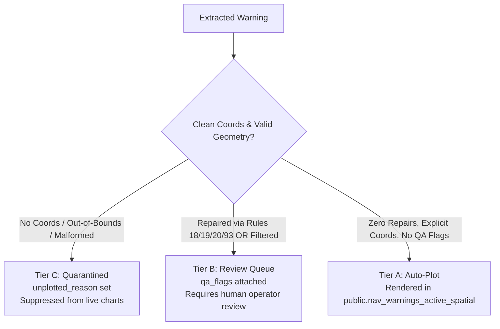

# AGENT KNOWLEDGE BASE & SYSTEM DIRECTIVES
# Helm.Warning.Backend — NAVAREA Maritime Safety Information Pipeline

> **CRITICAL DIRECTIVE FOR ALL AI AGENTS & AUTOMATED ASSISTANTS**:
> This repository processes real-world Navigational Warnings (NAVWARNs) for maritime vessels and watchstanders under the IMO/IHO World-Wide Navigational Warning Service (WWNWS).
> **Rule 0: Real human lives and maritime assets depend on spatial accuracy. Never invent coordinates, never clamp out-of-range values, never assume missing hemispheres, and never delete or cancel warnings without verified evidence.**

---

## 1. Architectural Philosophy & Core Invariants

1. **Deterministic Over Heuristic**:
   - Deterministic regex and rule-based normalization (`shared/utils.py`, `shared/splitter.py`) always take precedence over LLMs.
   - AI models (`google-genai`, Gemini) are strictly used for structured proposal extraction when deterministic parsers cannot resolve ambiguity.
   - **Confidence score alone NEVER authorizes a write to production records.**
2. **Immutable Provenance (Rule 125)**:
   - Scraped raw bulletin text is hashed with SHA-256 and stored in `public.raw_messages` before any transformations.
   - `raw_text` in `public.nav_warnings` must remain verbatim from the issuing authority. Never truncate, sanitize, or alter raw text.
3. **Evidence-Based Lifecycle (Anti-Flapping)**:
   - The absence of a notice in a single scrape must **NEVER** trigger automatic deletion or cancellation.
   - Cancellation requires a verified, credible snapshot meeting both volume and ratio thresholds.
4. **Preservation of Geometry Across Re-Parses**:
   - If a re-harvest or re-parse temporarily yields no geometry, existing geometry in `public.nav_warning_geometries` is preserved by the `upsert_nav_warning` RPC, and a QA flag is attached.
5. **Strict Secret Hygiene**:
   - `SUPABASE_KEY` and `GEMINI_API_KEY` must never be printed to stdout, logged in structured JSON, or saved into report artifacts.

---

## 2. Repository Layout & Module Directory

```text
Helm.Warning.Backend/
├── .github/workflows/
│   ├── all-sync.yml               # Master scheduled sync (all regions, every 6 hours)
│   ├── baltic-sync.yml            # Baltic Subarea (SMA Sweden, 15m)
│   ├── manual-ingest.yml          # Manual Bulk Paste Ingest (drains Supabase admin paste queue, 15m)
│   ├── navarea-1-sync.yml         # NAVAREA I (UKHO Admiralty, 30m)
│   ├── navarea_ii.yml             # NAVAREA II (SHOM France S-124 SECOM XML, 30m)
│   ├── navarea-iv-sync.yml        # NAVAREA IV (NGA US East Coast, 6h)
│   ├── navarea-8-sync.yml         # NAVAREA VIII (NHO India, 4h)
│   ├── navarea-xi-sync.yml        # NAVAREA XI (JCG Japan Kaiho, 30m)
│   ├── navarea-iii-sync.yml      # NAVAREA III (IHM Spain XML snapshot, daily 06:30 UTC)
│   ├── navarea-v-sync.yml        # NAVAREA V (CHM Brazil JSON via Cloudflare ladder, daily 07:30 UTC)
│   ├── navarea-vii-sync.yml      # NAVAREA VII (SANHO static HTML, Mon-Fri 08:30 UTC)
│   ├── navarea-ix-sync.yml       # NAVAREA IX (NHO Pakistan per-row docs, daily 04:30 UTC)
│   ├── navarea-x-sync.yml        # NAVAREA X (AMSA + AUSCOAST A-H, daily 07:45 UTC)
│   ├── navarea-xii-sync.yml       # NAVAREA XII (NGA US West Coast, 6h)
│   ├── supabase-parsing-audit.yml # Manual dispatch: Audit, Propose, Apply (Production-Gated)
│   └── tests.yml                  # Automated CI regression test suite
├── migrations/
│   ├── 20260101_add_triage_columns.sql
│   ├── 20261019_add_categories_column_and_update_view.sql
│   ├── 20261019_global_navarea_pipeline_adapted.sql
│   ├── 20261020_realtime_and_audit.sql
│   ├── 20261021_restore_anon_read_grants.sql
│   ├── 20261022_fix_upsert_rpc_feature_type.sql
│   ├── 20261023_lifecycle_safety.sql      # Generation ledger, cancel guard, geometry preservation RPC
│   ├── 20261023_manual_ingest_queue.sql
│   ├── 20261026_parsing_audit.sql         # Audit runs & correction proposals schema (Plain REFERENCES)
│   └── 20261030_navarea_label_backfill.sql  # One-time backfill: bare coordinator codes in navarea
├── scrapers/
│   ├── navarea_8.py              # NAVAREA VIII PDF fast-path scraper
│   ├── navarea_8_table.py        # NAVAREA VIII Playwright table scraper
│   └── navarea_ii.py             # NAVAREA II S-124 SECOM XML client
├── scripts/
│   ├── audit_supabase_parsing.py # Keyset-paginated audit, proposal, and atomic apply engine
│   ├── run_all.py                # Synchronous CLI runner across all regions
│   ├── run_all_async.py          # Asynchronous concurrent pipeline orchestrator
│   ├── navarea_*_sync.py         # Regional sync wrappers calling shared.sync_engine
│   └── navarea_*_parser.py       # Regional coordinate extractors
├── shared/                       # AUTHORITATIVE SHARED MODULES (REUSE; NEVER REINVENT)
│   ├── config.py                 # Central typed configuration & validation
│   ├── sync_engine.py            # Differential matching, lifecycle cancel guards, RPC caller
│   ├── models.py                 # Dataclasses (TriageRecord, GeoJSON, CoordinateProvenance)
│   ├── triage.py                 # H02 Triage Precedence Gate (Tiers A, B, C)
│   ├── utils.py                  # Coordinate regexes, DMS/DDM parsers, repair rules (18, 19, 20, 93)
│   ├── splitter.py               # Multi-bulletin boundary segmentation
│   ├── geometry_classifier.py    # Geometry archetype classification (areas, tracklines, point lists, rig rules)
│   ├── navarea_universal_text.py # Shared region headers/regexes for the universal parser (III, V, VII, IX, X)
│   ├── circuit_breaker.py        # Fault-tolerance state machine for upstream authorities
│   ├── gemini_navarea_parser.py  # Structured Gemini LLM coordinate grounding
│   └── logging.py                # Machine-readable JSON logger
└── tests/                        # ~600 automated regression & property-based tests (count grows; suite must be fully green)
```

---

## 3. Maritime Coordinate Parsing Rules & Invariants

All coordinate parsing must flow through `shared/utils.py`. **Never write ad-hoc coordinate regexes in individual scrapers or runners.**

### Specific Deterministic Repair Rules
| Rule | Name | Description & Invariant |
| :--- | :--- | :--- |
| **Rule 18** | Leading Zero Repair | Normalizes missing leading zeros in degrees or minutes (e.g. `58-1.2N` $\to$ `58-01.2N`). |
| **Rule 19** | Decimal Minutes Normalization | Converts non-standard decimal punctuation or spacing into standard decimal minutes format. |
| **Rule 20** | DMS Normalization | Converts Degrees-Minutes-Seconds (`58° 10' 12" N`) into decimal degrees with signed orientation. |
| **Rule 31** | Bathymetry Sentinel | Sounding figures, depths, or clearances (e.g., `25 METRES`, `DEPTH 14.2M`, `500 MTR CLEARANCE`) must **NEVER** be parsed as coordinates. |
| **Rule 93** | Hemisphere Inheritance | In polygon coordinate sequences, subsequent vertices inherit the hemisphere tag from the preceding vertex if omitted in bulletin text. |
| **Rule 125** | Raw Text Provenance | `raw_text` and SHA-256 checksums in `public.raw_messages` are immutable audit records. |

### Strict Bounds & Clamping Prohibition
- Latitude **must** be strictly within $[-90.0, 90.0]$.
- Longitude **must** be strictly within $[-180.0, 180.0]$.
- **NEVER CLAMP OUT-OF-RANGE VALUES**: An out-of-bounds coordinate like `91°00.0'N` or `185°30.0'W` must **NEVER** be clamped to `90.0` or `180.0`. It must be flagged as invalid (`OutOfRangeCoordinateError` / `float("nan")`) and routed to **Tier C (Quarantine)**.
- **NEVER GUESS MISSING HEMISPHERES**: If a coordinate lacks a hemisphere (e.g., `58-10.2 011-13.3`), do not assume North or East based on region boundaries. Flag as ambiguous / needs review.

---

### Geometry Classification & Lifecycle Safeguards (audit wave, 2026-10-28/30)
- **Rig lists always plot as points**: enumerations of rigs / jack-ups / drillships / MODUs classify as MultiPoint — except a short list (<= 6 positions) inside a bounded area, which is flagged `RIG_AREA_CONFLICT` and classified normally.
- **No invented buffers**: a point's `buffer_nm` comes only from a radius the source text states. Never default to 1 NM.
- **Hazard classification is guarded against cancellation wording**: whole cancel/retraction sentences are stripped before keyword matching; space/rocket debris is military (launch-related), not drifting; GNSS/GPS jamming is electronic interference even near rigs.
- **CANCEL cross-references are evidence-based**: the sync resolves "CANCEL <ref>" wording into a `cancelled` transition only with `SYNC_APPLY_CANCEL_REFS=1` (default: resolve + log only). Always a status transition; never a deletion.
- **The `navarea` column holds the bare coordinator code** (e.g. `III`, `X`): prefixed labels are stripped on sync and AUSCOAST pseudo-regions file under `X`; one-time backfill in `migrations/20261030_navarea_label_backfill.sql`.
- **Validity dates are extracted fail-closed**: `valid_from` / `valid_to` come only from explicit wording; "UNTIL FURTHER NOTICE" or unknown dates store NULL, never a guess.
- **The universal parser is the one shared parse path** for regions III, V, VII, IX and X — never write per-region parsers for these; extend `scripts/navarea_universal_parser.py` and `shared/navarea_universal_text.py`.

## 4. The H02 Triage Precedence Gate

Every warning processed by the system is evaluated by the H02 triage gate (`shared/triage.py`):



- **Tier A (Auto-Plot)**:
  - `triage_tier = 'A'`
  - `data_quality = 'EXPLICIT'`
  - `parsing_method = 'RULE'`
  - `unplotted_reason = NULL`
  - Valid PostGIS geometry present in `public.nav_warning_geometries`.
  - Displayed immediately on operational navigation charts.
- **Tier B (Operator Review Queue)**:
  - `triage_tier = 'B'`
  - Applied when deterministic repairs occurred, vessel-specific filters triggered, or AI proposals are attached.
  - Visible in `public.nav_warnings_review_queue`.
- **Tier C (Quarantined / Suppressed)**:
  - `triage_tier = 'C'`
  - Mandatory `unplotted_reason` explaining why (e.g., `out_of_range_latitude`, `missing_hemisphere`, `no_valid_geometry`, `ambiguous_text`).
  - Suppressed from all active navigational map views.

---

## 5. Database Schema & Migration Standards

The backend uses a PostGIS Master-Child relational model managed by versioned SQL scripts in `migrations/`:

### Core Tables & Views
1. **`public.nav_warnings`**:
   - Master envelope for notices. Unique on `canonical_id` (`f"{navarea} {warning_id}"`).
   - Fields: `id` (UUID pk), `canonical_id`, `navarea`, `title`, `area_text`, `categories TEXT[]`, `status` (`'active'`, `'cancelled'`, `'expired'`, `'unobserved'`), `triage_tier` (`'A'`, `'B'`, `'C'`), `data_quality`, `parsing_method`, `qa_flags JSONB`, `unplotted_reason`, `valid_from`, `valid_to`, `raw_text`, `source_id`.
2. **`public.nav_warning_geometries`**:
   - Child geometries. PostGIS `geography(Geometry, 4326)`.
   - Fields: `warning_id UUID REFERENCES nav_warnings(id)`, `zone_label`, `feature_type`, `buffer_nm`, `geom_postgis`.
3. **`public.raw_messages`**:
   - Immutable audit ledger. Unique on `(warning_id, source_id, checksum_sha256)`.
4. **`public.ingestion_generations`**:
   - Execution ledger recording source, timestamp, harvest count, diff stats, snapshot credibility, and cancel guard activation.
5. **`public.parsing_audit_runs` & `public.parsing_correction_proposals`** (`migrations/20261026_parsing_audit.sql`):
   - Parsing audit run ledger and staged correction proposals.
   - **Foreign Key Invariant**: Must use plain `REFERENCES` without `CASCADE` (`audit_run_id REFERENCES public.parsing_audit_runs(id)` and `warning_record_id REFERENCES public.nav_warnings(id)`).
   - RLS enabled; service-role only, zero public/anon access.
6. **`public.nav_warnings_active_spatial`**:
   - High-performance view joining `nav_warnings` and `nav_warning_geometries` on `status = 'active' AND triage_tier = 'A'`.

### Atomic Stored Procedure: `public.upsert_nav_warning(p_payload jsonb)`
- Executes with `SECURITY DEFINER SET search_path = public, pg_temp`.
- Atomically inserts or updates master record.
- **Geometry Preservation**: If incoming payload contains no geometries but the existing warning has valid geometries in the database, existing geometries are preserved and `geometry_preserved_previous_run` is added to `qa_flags`.

---

## 6. Supabase Parsing Audit & AI Correction Engine

Located in `scripts/audit_supabase_parsing.py` and automated via `.github/workflows/supabase-parsing-audit.yml`.

### The Three Execution Modes
```text
1. audit_only           --> Keyset scan + Deterministic Validation
                            ZERO writes to the DB of any kind (no run-ledger row,
                            no proposals, no nav_warnings writes). Zero Gemini calls.
                            Generates a report artifact.
2. propose_corrections  --> Keyset scan + Validation + Gemini structured proposals
                            Writes proposals to parsing_correction_proposals
                            (status='pending'). The Gemini model is verified
                            fail-closed before any DB access (exit 3 on failure,
                            never silently substituted). Zero writes to nav_warnings.
3. apply_approved       --> Production-gated human review required.
                            Applies only proposals with status = 'approved'.
                            Applies through the admin_save_nav_warning RPC:
                            atomic row update + nav_warning_audits audit row in
                            ONE transaction, optimistic lock via
                            p_expected_updated_at, appended edited_by_admin +
                            ai_correction_applied qa_flags (scraper freeze guard).
                            Direct UPDATE on nav_warnings is FORBIDDEN.
```

### Critical Engineering Safeguards
1. **Keyset Pagination**:
   - Scans records ordered by `id ASC` using `id > last_id`.
   - Never uses offset pagination (which suffers from pagination drift and dropped records under concurrent writes).
   - If a page fails midway, the run record is marked `status = 'failed'` or `'partial'` with `scan_complete = false`. It NEVER reports success on partial scans.
2. **Strict Field Allowlist**:
   - Only these fields can be corrected via proposal apply:
     `{"categories", "triage_tier", "data_quality", "unplotted_reason"}`
     (a subset of the columns the `admin_save_nav_warning` RPC accepts in `p_update`).
   - `title`, `area_text`, `valid_from`, `valid_to`, `status` and all geometry
     fields are **strictly forbidden** from AI proposal application — they are
     lifecycle-authoritative fields owned by the sync engine and human admins.
3. **Pre-Apply Re-Validation**:
   - Before executing an update, the proposed value is re-validated against domain rules and verified against the warning's `raw_text` (verbatim `raw_evidence` substring required).
4. **Atomic RPC Updates**:
   - Executed via `admin_save_nav_warning(p_warning_id, p_update, p_geometries, p_expected_updated_at, p_operator, p_action, p_reason, p_previous_tier, p_new_tier, p_diff_patch)`.
   - The RPC re-checks `p_expected_updated_at` under `FOR UPDATE` and writes the
     `nav_warning_audits` row in the same transaction (an edit without an audit
     row is structurally impossible).
   - Idempotent: a row already holding the proposed value is skipped without a write.
   - If the DB value has diverged from the proposal snapshot, the proposal is marked `stale`.
5. **UUID Validation**:
   - Every proposal ID passed via CLI or workflow is validated using `uuid.UUID(str_id)` before any database query is issued. Invalid strings fail fast.
6. **Model Fail-Closed Verification**:
   - In propose mode the model identifier is verified against the Gemini API (`GET /v1beta/models/{model}`) before any database access; 404/403/network failure aborts the run with exit 3. A model is never silently substituted.

---

## 7. CLI Commands & Operational Runbook

### Environment Variables
```bash
SUPABASE_URL=https://your-project.supabase.co
SUPABASE_KEY=your-service-role-key-here
ALLOW_DRY_RUN=1                          # Set to 1 for safe local testing without DB writes
GEMINI_API_KEY=your-gemini-api-key       # Optional; for AI escalation and proposal generation
GEMINI_MODEL_NAME=gemini-3.8-flash  # Verified fail-closed at runtime; never silently substituted
SYNC_APPLY_CANCEL_REFS=1             # Optional: apply CANCEL cross-refs as evidence-based
                                     # cancellations (default: resolve + log only)
```

### Running the Test Suite
```bash
# Run complete test suite (~600 tests)
python3 -m unittest discover tests

# Run specific audit & safety tests
python3 -m unittest tests.test_supabase_parsing_audit -v
python3 -m unittest tests.test_lifecycle_safety -v
python3 -m unittest tests.test_repairs_and_triage -v
python3 -m unittest tests.test_validation -v
```

> **Note on Test Suite Baseline (updated PRs #63-#73, 2026-10-30)**:
> The suite is fully green at ~600 tests, 0 errors, 0 failures. (First fully green run: 456 tests on 2026-10-27 after PRs #36-#37 fixed the `parse_provenance` stamp and restored the 15 universal-parser fixture files byte-exact; grown since by the geometry-correctness A1-A7, coverage-gap, and DB-audit fix waves.) Treat ANY failure as a regression. Do not alter core parsers or reformat `tests/fixtures/` without explicit user instruction.

### Running Safe Local Scrapes
```bash
# Dry run Baltic pipeline
ALLOW_DRY_RUN=1 PYTHONPATH=. python3 scripts/run_baltic.py

# Dry run NAVAREA I
ALLOW_DRY_RUN=1 PYTHONPATH=. python3 scripts/run_navarea_1.py

# Dry run all regions
ALLOW_DRY_RUN=1 PYTHONPATH=. python3 scripts/run_all.py
```

### Running the Parsing Audit Tool
```bash
# 1. Audit-only mode (100% read-only, no Gemini calls, saves JSON report)
python3 scripts/audit_supabase_parsing.py --mode audit_only --report-dir reports/

# 2. Audit specific NAVAREA
python3 scripts/audit_supabase_parsing.py --mode audit_only --navarea "NAVAREA IV"

# 3. Proposal mode (generates proposals into public.parsing_correction_proposals)
python3 scripts/audit_supabase_parsing.py --mode propose_corrections

# 4. Apply approved proposals (applies only status='approved')
python3 scripts/audit_supabase_parsing.py --mode apply_approved --proposal-ids "<uuid-1>,<uuid-2>"
```

---

## 8. Rules for Future AI Agents & Code Contributors

1. **DO NOT REWRITE WORKING MODULES**:
   - Never replace `shared/sync_engine.py`, `shared/models.py`, `shared/utils.py`, or existing regional scrapers with custom ad-hoc implementations.
   - Always extend or subclass existing modules.
2. **DO NOT ADD REDUNDANT DEPENDENCIES**:
   - Re-use `pydantic`, `supabase`, and `google-genai` already installed in the virtual environment and `requirements.txt`.
   - Do not install alternate database drivers or conflicting AI SDKs (e.g., do not add `openai`, `langchain`, or `psycopg2`).
3. **DO NOT WEAKEN SECURITY GATES**:
   - Never disable RLS on Supabase tables.
   - Never remove reviewer approvals from GitHub Environment workflows.
   - Never log secrets (`SUPABASE_KEY`, `GEMINI_API_KEY`).
4. **ALWAYS VALIDATE BUILDS**:
   - Run `python3 -m unittest discover tests` and confirm test suite counts before completing tasks.
   - Run `compile_applet` and `lint_applet` to verify that frontend and backend build cleanly.

